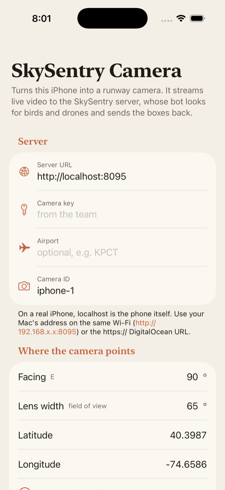
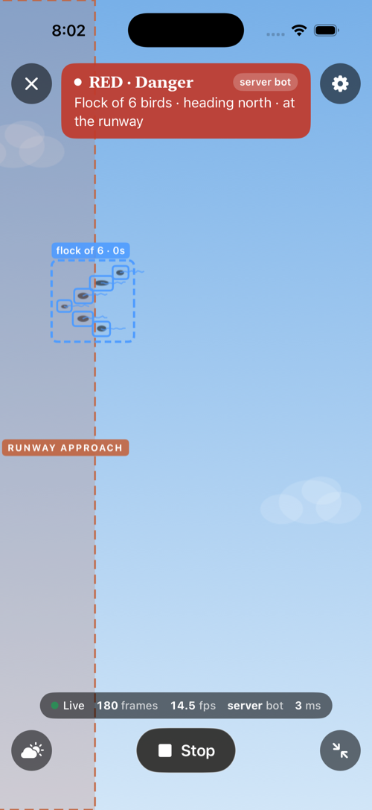

# SkySentry Camera (iPhone)

A native iPhone app that turns the phone into a runway camera. It streams its live rear-camera video to the SkySentry server (`PRANAV/server.js`). The server's detection bot looks for birds and drones and sends back tracks, flocks and a risk level, which the app draws over the video. The phone does no detection itself.

SwiftUI + AVFoundation + URLSession only. There are no third-party packages, so it builds offline. iOS 17+, bundle id `com.skysentry.camera`.

| Setup | Streaming the demo sky to a local server |
|---|---|
|  |  |

## Open and run
1. Open `ATHARV/ios/SkySentryCam.xcodeproj` in Xcode 26 (or Xcode 16 or later).
2. Pick the **SkySentryCam** scheme and an iPhone simulator, then press Run.
3. In Setup, enter the server URL and camera key, then tap **Open camera** and **Start streaming**.

The simulator has no camera, so the app streams the **Demo sky** instead: a light-blue sky with a V of six birds flying right to left, wings beating about 4 times a second. The model is copied from Vivan's `synthetic.js`. You can also choose Demo sky on a real phone (Setup › Video source, or the cloud button on the camera screen).

From the command line:
```sh
cd ATHARV/ios
xcodebuild -project SkySentryCam.xcodeproj -scheme SkySentryCam \
  -destination 'platform=iOS Simulator,name=iPhone 17 Pro' build
```
Testing hooks (launch arguments, not saved):
`xcrun simctl launch booted com.skysentry.camera -autoOpenCamera YES -autoStart YES -apiKey <key> [-serverURL http://…] [-cameraId sim-1]`

## What it does
- **Setup** (saved with `@AppStorage`): server URL, camera key, airport code, camera ID, compass heading and lens width, latitude/longitude ("Use my location & compass" fills them), runway corridor side and width, and video source.
- **Camera**: full-screen 1280x720 rear camera (or demo sky). Frames are scaled to 640 px wide, JPEG quality 0.6, and encoded off the main thread. They are POSTed at most about 15 fps with **only one request in flight**: frames that arrive while a request is pending are dropped, so a slow link lowers the frame rate instead of adding delay.
- **Overlay**: corridor (terracotta), track boxes (bird blue, drone red, unknown amber), trails, and flock boxes with "flock of N · Xs" labels. Everything is mapped to the visible video area for both Fill and Fit (button at bottom right).
- **Banner**: risk colour (green/yellow/red) plus a line such as "Flock of 6 birds · heading south · 9 s to runway". Stats: status, frames sent, fps achieved, server/tower bot, and bot processing ms.
- Keeps the screen awake while streaming. Errors are explained clearly: wrong key (401) stops streaming; an unreachable server retries every second; denied camera access shows an **Open Settings** button.
- If the server bot hands over to the towers (`"bot":"tower"`), the server's HTTP state stops updating. The app then hides the old boxes and says the tower is detecting.

## API used
Headers on every call: `x-api-key`, `x-camera-id`, and optionally `x-airport`.
- `POST /api/camera-config` with `{camera:{lat,lon,heading_deg,hfov_deg}, corridor:[[x,y],…]}`. Sent on Start and whenever settings change.
- `POST /api/camera-frame` with raw JPEG, `Content-Type: image/jpeg`, and `x-frame-time: <seconds since Start>`. Returns `{ok, bot, state}`.

## Real iPhone (free Apple ID)
1. Plug the iPhone into the Mac and tap **Trust**. On iOS 16+, turn on **Settings › Privacy & Security › Developer Mode** and restart when asked.
2. In Xcode: **Settings › Accounts › +** and sign in with your Apple ID.
3. Select the **SkySentryCam** target › **Signing & Capabilities**. Keep "Automatically manage signing" on and choose your **Personal Team**. If the bundle id is taken, change it to something unique, e.g. `com.yourname.skysentry`.
4. Choose your iPhone as the run destination and press Run.
5. The first launch says "Untrusted Developer". On the phone, open **Settings › General › VPN & Device Management**, tap your Apple ID, then **Trust**. Launch again.
6. Allow camera access. Apps signed with a free account expire after **7 days**; run again from Xcode to refresh.

Server address on the phone: `localhost` means the phone itself. Use the deployed `https://…ondigitalocean.app` URL, or your Mac's Wi-Fi address (`http://192.168.x.x:8095`, from `ipconfig getifaddr en0`) with the phone on the same Wi-Fi. Allow the "local network" prompt. Plain `http://` only works for local addresses (ATS `NSAllowsLocalNetworking`); everything else must be `https://`.
