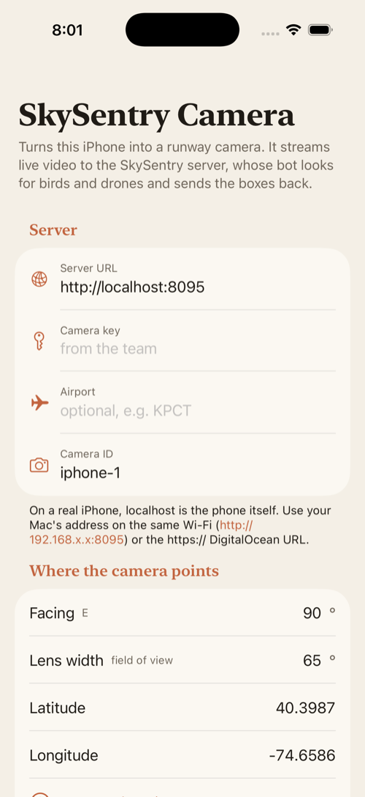
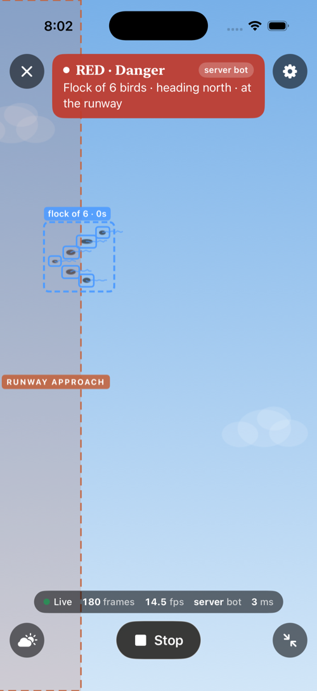

# SkySentry Camera (iPhone)

A native iPhone app that streams rear-camera JPEGs to the SkySentry server (`PRANAV/server.js`). The server evaluates video and returns tracks, flocks and an advisory risk level when results are usable. The JPEG stream carries no drone audio. The app does not give clearance.

SwiftUI + AVFoundation + URLSession only. There are no third-party packages, so it builds offline. iOS 17+, bundle id `com.skysentry.camera`.

| Setup | Illustrated sky preview |
|---|---|
|  |  |

## Open and run
1. Open `ATHARV/ios/SkySentryCam.xcodeproj` in Xcode 26 (or Xcode 16 or later).
2. Pick the **SkySentryCam** scheme and an iPhone simulator, then press Run.
3. In Setup, enter the server URL and camera key, then tap **Open camera** and **Start streaming**.

The simulator has no rear camera. Use **Demo sky** to preview a synthetic flock locally. Demo sky and downloaded clips never enter the live uploader or test the tower's detector, reports or alert sound.

From the command line:
```sh
cd ATHARV/ios
xcodebuild -project SkySentryCam.xcodeproj -scheme SkySentryCam \
  -destination 'platform=iOS Simulator,name=iPhone 17 Pro' build
```
Testing hooks (launch arguments, not saved):
`xcrun simctl launch booted com.skysentry.camera -autoOpenCamera YES -autoStart YES -apiKey <key> [-serverURL http://…] [-cameraId sim-1]`

## What it does
- **Setup** (saved with `@AppStorage`): server URL, camera key, airport code, camera ID, compass heading and lens width, latitude/longitude ("Use my location & compass" fills them), runway corridor side and width, and video source.
- **Camera**: full-screen 1280x720 rear camera (or demo sky). Frames are scaled to 640 px wide, JPEG quality 0.6, and encoded off the main thread. They are POSTed at most about 15 fps with **only one request in flight**: frames that arrive while a request is pending are dropped, so a slow link lowers the frame rate instead of adding delay.
- **Overlay**: corridor (terracotta), track boxes (bird blue, drone red, unknown amber), trails, and flock boxes with "flock of N · Xs" labels. Everything is mapped to the visible video area for both Fill and Fit (button at bottom right).
- **Banner**: server-assigned risk and coverage. Green indicates no detections in monitored video, not clearance. An estimate for a surveyed image mask is not time to runway arrival.
- Keeps the screen awake while streaming. Unauthorized access stops streaming; a connection failure can retry; denied camera access shows an **Open Settings** button.
- If usable server results expire, the app hides stale annotations. The tower does not take over detection.

## API used
Live requests use `x-api-key`, the matching `x-airport`, a persistent `x-camera-device`, the current `x-camera-session`, and `x-camera-source: live`. `x-camera-id` is an optional label, not identity.
- `POST /api/camera-config` with `source: live` and camera pose. Only server-configured survey data can activate a corridor.
- `POST /api/camera-frame` with raw JPEG, `Content-Type: image/jpeg`, and `x-frame-time: <seconds since Start>`. `bot`, detector status, `at` and `remaining_ms` describe the usability of the returned state.
- `POST /api/camera-stop` ends the matching stream.

## Real iPhone (free Apple ID)
1. Plug the iPhone into the Mac and tap **Trust**. On iOS 16+, turn on **Settings › Privacy & Security › Developer Mode** and restart when asked.
2. In Xcode: **Settings › Accounts › +** and sign in with your Apple ID.
3. Select the **SkySentryCam** target › **Signing & Capabilities**. Keep "Automatically manage signing" on and choose your **Personal Team**. If the bundle id is taken, change it to something unique, e.g. `com.yourname.skysentry`.
4. Choose your iPhone as the run destination and press Run.
5. The first launch says "Untrusted Developer". On the phone, open **Settings › General › VPN & Device Management**, tap your Apple ID, then **Trust**. Launch again.
6. Allow camera access. Apps signed with a free account expire after **7 days**; run again from Xcode to refresh.

Server address on the phone: `localhost` means the phone itself. For approved development use an isolated server, such as the Mac's Wi-Fi address on the same network. Allow the local network prompt. Plain `http://` only works for local addresses (ATS `NSAllowsLocalNetworking`); other addresses must use HTTPS. Do not send test frames to the public deployment.
